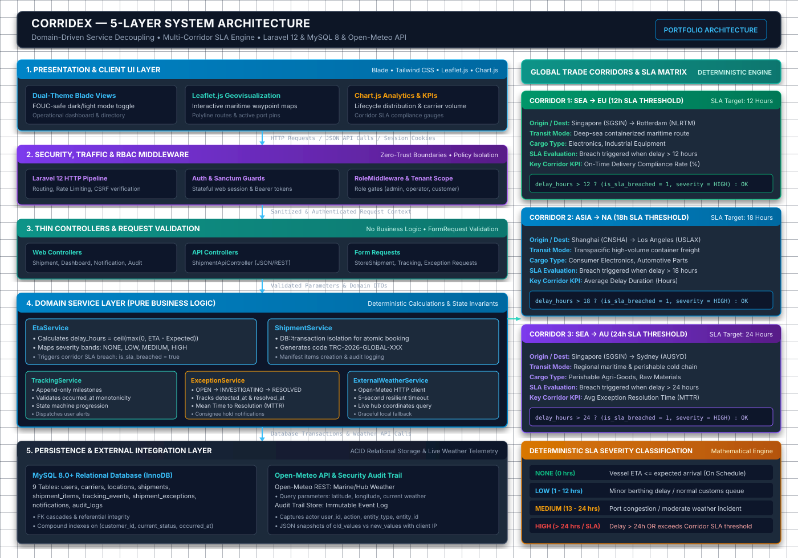
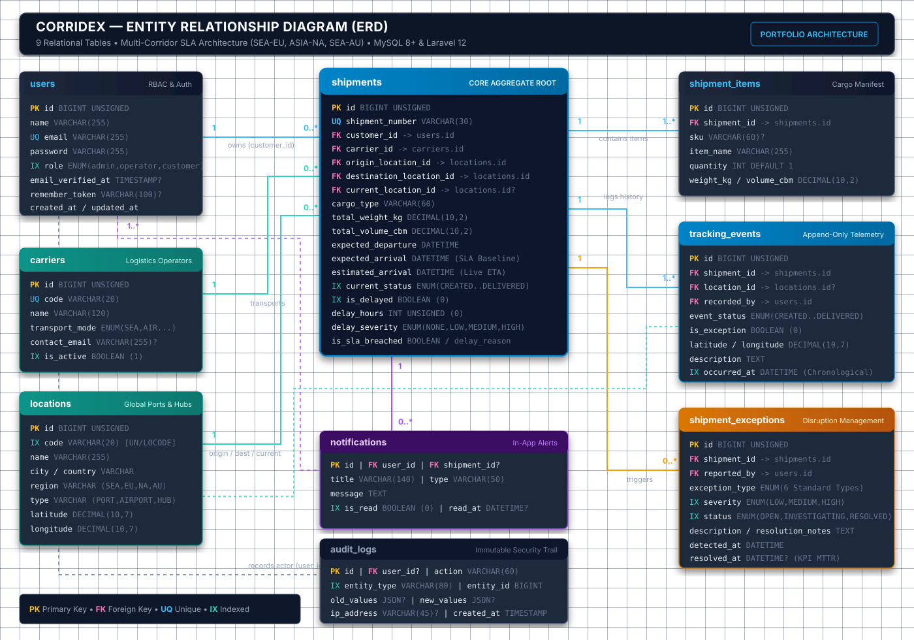

# Corridex: Multi-Corridor Freight Visibility Engine

[](https://laravel.com)
[](https://php.net)
[](https://www.mysql.com)
[-brightgreen.svg)]()

> **Brand Philosophy:** The name **Corridex** is a portmanteau of **Corridor** (anchored in three strategic international trade arteries: **SEA-EU**, **ASIA-NA**, and **SEA-AU**) and **Index** (a mathematical baseline for route reliability, deterministic ETA tracking, and precision SLA analytics).

Corridex is an enterprise multi-corridor freight visibility and tracking engine built with Laravel 12, PHP 8.3, MySQL 8, Tailwind CSS, Leaflet.js, and Chart.js. It delivers real-time visibility across global maritime and multimodal shipping lanes, deterministic delay and SLA breach calculations, append-only chronological tracking timelines, live hub weather telemetry via Open-Meteo, and strict server-side role-based access control (RBAC).

---

## Table of Contents
1. [Problem Statement and Domain Scope](#1-problem-statement-and-domain-scope)
2. [System Architecture and Service Layer](#2-system-architecture-and-service-layer)
3. [Relational Database Schema (ERD and 9 Core Tables)](#3-relational-database-schema-erd-and-9-core-tables)
4. [Deterministic ETA and SLA Engine](#4-deterministic-eta-and-sla-engine)
5. [Global Trade Corridor Scenarios](#5-global-trade-corridor-scenarios)
6. [Role-Based Access Control (RBAC)](#6-role-based-access-control-rbac)
7. [Environment and Laragon Execution Setup](#7-environment-and-laragon-execution-setup)
8. [Demo Credentials](#8-demo-credentials)
9. [RESTful API Endpoints](#9-restful-api-endpoints)
10. [Automated Test Suite and Verification](#10-automated-test-suite-and-verification)

---

## 1. Problem Statement and Domain Scope

International ocean and air freight logistics face severe operational and data integrity issues:
- **Mutable Waypoint Timelines**: Legacy tracking software frequently updates or overwrites historical transit records, preventing compliance audits.
- **Subjective Delay Assessment**: Carrier operators assign delay status arbitrarily without mathematical thresholds or corridor SLAs.
- **Unmanaged Operational Exceptions**: Customs holds, port congestion, and weather diversions lack structured resolution lifecycles and Mean Time to Resolution (MTTR) tracking.
- **Cross-Tenant Data Exposure**: Many portals fail to isolate consignee data, exposing shipment volumes, items, and trade partners to competitors.

Corridex addresses these issues through:
1. **Append-Only Chronological Tracking Engine**: Historical waypoints are immutable. New milestones must have timestamps greater than or equal to the previous milestone.
2. **Deterministic Delay and SLA Calculation**: Mathematical comparison between estimated arrival and expected arrival, evaluated against trade corridor thresholds (SEA-EU: 12h, ASIA-NA: 18h, SEA-AU: 24h).
3. **Live Hub Weather Telemetry**: Direct integration with the Open-Meteo weather API to display current conditions at active hubs without third-party tracking cookies.
4. **Strict Server-Side RBAC**: Middleware and policy rules that isolate customers to their own shipments while providing operators and administrators with auditing and mutation controls.

---

## 2. System Architecture and Service Layer



Corridex decouples HTTP controllers from domain logic using dedicated service classes:

```
[ HTTP Requests / API Clients ]
              │
              ▼
[ Route Middleware (auth, sanctum, role:admin,operator) ]
              │
              ▼
[ Controllers (Web\ShipmentController, Api\ShipmentApiController) ]
              │
              ▼
[ Service Layer ]
  ├── EtaService              (Calculates delays and evaluates corridor SLA breaches)
  ├── ShipmentService         (Atomic shipment creation, manifest itemization, audit logging)
  ├── TrackingService         (Enforces state transitions, validates event chronology, dispatches alerts)
  ├── ExceptionService        (Tracks exception lifecycle, records MTTR, alerts consignees)
  └── ExternalWeatherService  (Fetches Open-Meteo weather data with 5s timeout and local fallback)
              │
              ▼
[ Eloquent Models and Database Transactions ]
              │
              ▼
[ MySQL 8 Relational Database ]
```

### Domain Services
- [`App\Services\EtaService`](file:///D:/laragon/www/cargotrace/cargotrace/app/Services/EtaService.php): Calculates delay hours as a whole number rounded up, maps them to severity bands (`NONE`, `LOW`, `MEDIUM`, `HIGH`), and evaluates corridor SLA breach conditions.
- [`App\Services\ShipmentService`](file:///D:/laragon/www/cargotrace/cargotrace/app/Services/ShipmentService.php): Wraps shipment creation in database transactions, generates tracking codes (`TRC-2026-GLOBAL-XXX`), writes initial tracking records, and logs audit events.
- [`App\Services\TrackingService`](file:///D:/laragon/www/cargotrace/cargotrace/app/Services/TrackingService.php): Validates state machine progression (`CREATED` -> `BOOKED` -> `PICKED_UP` -> `IN_TRANSIT` -> `DELIVERED`), verifies timestamp sequence, and creates recipient notifications.
- [`App\Services\ExceptionService`](file:///D:/laragon/www/cargotrace/cargotrace/app/Services/ExceptionService.php): Manages status progression (`OPEN` -> `INVESTIGATING` -> `RESOLVED`), records resolution timestamps, and calculates resolution hours.
- [`App\Services\ExternalWeatherService`](file:///D:/laragon/www/cargotrace/cargotrace/app/Services/ExternalWeatherService.php): Queries the Open-Meteo API using latitude and longitude coordinates with fallback support.

---

## 3. Relational Database Schema (ERD and 9 Core Tables)

The database schema enforces relational integrity using foreign keys, compound indexes, and cascading delete constraints.

### Entity Relationship Diagram (Visual)



### Entity Relationship Diagram (Mermaid)

```mermaid
erDiagram
    USERS ||--o{ SHIPMENTS : "places (customer_id)"
    USERS ||--o{ TRACKING_EVENTS : "records (recorded_by)"
    USERS ||--o{ SHIPMENT_EXCEPTIONS : "reports (reported_by)"
    USERS ||--o{ NOTIFICATIONS : "receives (user_id)"
    USERS ||--o{ AUDIT_LOGS : "acts (user_id)"

    CARRIERS ||--o{ SHIPMENTS : "operates (carrier_id)"

    LOCATIONS ||--o{ SHIPMENTS : "origin (origin_location_id)"
    LOCATIONS ||--o{ SHIPMENTS : "destination (destination_location_id)"
    LOCATIONS ||--o{ SHIPMENTS : "current (current_location_id)"
    LOCATIONS ||--o{ TRACKING_EVENTS : "locates (location_id)"

    SHIPMENTS ||--o{ SHIPMENT_ITEMS : "contains (shipment_id)"
    SHIPMENTS ||--o{ TRACKING_EVENTS : "tracks (shipment_id)"
    SHIPMENTS ||--o{ SHIPMENT_EXCEPTIONS : "flags (shipment_id)"
    SHIPMENTS ||--o{ NOTIFICATIONS : "triggers (shipment_id)"

    USERS {
        bigint id PK
        string name
        string email UK
        string password
        enum role "admin, operator, customer"
        datetime created_at
    }

    CARRIERS {
        bigint id PK
        string code UK
        string name
        enum transport_mode "SEA, AIR, LAND, MULTIMODAL"
        string contact_email
        boolean is_active IDX
    }

    LOCATIONS {
        bigint id PK
        string code IDX
        string name
        string city
        string country
        string region
        string type
        decimal latitude
        decimal longitude
    }

    SHIPMENTS {
        bigint id PK
        string shipment_number UK
        bigint customer_id FK
        bigint carrier_id FK
        bigint origin_location_id FK
        bigint destination_location_id FK
        bigint current_location_id FK
        string cargo_type
        decimal total_weight_kg
        decimal total_volume_cbm
        datetime expected_departure
        datetime expected_arrival
        datetime estimated_arrival
        enum current_status "CREATED, BOOKED, PICKED_UP, IN_TRANSIT, DELIVERED"
        boolean is_delayed
        int delay_hours
        enum delay_severity "NONE, LOW, MEDIUM, HIGH"
        boolean is_sla_breached
        string delay_reason
    }

    SHIPMENT_ITEMS {
        bigint id PK
        bigint shipment_id FK
        string sku
        string item_name
        int quantity
        decimal weight_kg
        decimal volume_cbm
    }

    TRACKING_EVENTS {
        bigint id PK
        bigint shipment_id FK
        bigint location_id FK
        bigint recorded_by FK
        enum event_status
        boolean is_exception
        decimal latitude
        decimal longitude
        text description
        datetime occurred_at IDX
    }

    SHIPMENT_EXCEPTIONS {
        bigint id PK
        bigint shipment_id FK
        bigint reported_by FK
        enum exception_type
        enum severity
        enum status IDX
        text description
        text resolution_notes
        datetime detected_at
        datetime resolved_at
    }

    NOTIFICATIONS {
        bigint id PK
        bigint user_id FK
        bigint shipment_id FK
        string title
        text message
        string type
        boolean is_read IDX
        datetime read_at
    }

    AUDIT_LOGS {
        bigint id PK
        bigint user_id FK
        string action
        string entity_type IDX
        bigint entity_id IDX
        json old_values
        json new_values
        string ip_address
        timestamp created_at
    }
```

---

### Relational Cardinality Explanation

| Relationship | Cardinality | Parent Table | Child Table | Foreign Key | Enforcement & Delete Policy | Operational Meaning |
|---|---|---|---|---|---|---|
| Customer Ownership | 1 : 0..* | `users` | `shipments` | `customer_id` | RESTRICT | A user with role `customer` places zero or many consignments. Parent user records cannot be deleted if active shipments reference them. |
| Freight Carriage | 1 : 0..* | `carriers` | `shipments` | `carrier_id` | RESTRICT | A carrier operates zero or many shipments across ocean/air routes. Deletion is restricted to prevent orphaned manifests. |
| Origin Terminal | 1 : 0..* | `locations` | `shipments` | `origin_location_id` | RESTRICT | Origin departure port or hub. Restricted from deletion when bound to shipments. |
| Destination Terminal | 1 : 0..* | `locations` | `shipments` | `destination_location_id` | RESTRICT | Destination discharge port or terminal. Protected against deletion. |
| Current Waypoint | 1 : 0..* | `locations` | `shipments` | `current_location_id` | SET NULL | Live waypoint hub location. Cleared to NULL if a temporary waypoint node is removed. |
| Cargo Manifest Itemization | 1 : 1..* | `shipments` | `shipment_items` | `shipment_id` | CASCADE | Every consignment requires at least one manifest item. Deleting a consignment removes its manifest items. |
| Append-Only Telemetry | 1 : 1..* | `shipments` | `tracking_events` | `shipment_id` | CASCADE | Every consignment maintains an immutable timeline of milestones starting at `CREATED`. |
| Milestone Hub Location | 1 : 0..* | `locations` | `tracking_events` | `location_id` | SET NULL | Physical terminal where the milestone occurred. Cleared to NULL if the location is archived. |
| Event Recording Actor | 1 : 0..* | `users` | `tracking_events` | `recorded_by` | RESTRICT | Operator account that registered the milestone. Preserved for regulatory compliance. |
| Disruption Exceptions | 1 : 0..* | `shipments` | `shipment_exceptions` | `shipment_id` | CASCADE | Shipments trigger zero or more operational disruptions (e.g., customs holds, weather diversions). |
| Exception Reporting Actor | 1 : 0..* | `users` | `shipment_exceptions` | `reported_by` | RESTRICT | Operator reporting the disruption. Retained for MTTR metrics and accountability. |
| Consignment Alerts | 1 : 0..* | `shipments` | `notifications` | `shipment_id` | CASCADE | Shipments dispatch alerts for delay threshold breaches and milestone transitions. |
| User In-App Inbox | 1 : 0..* | `users` | `notifications` | `user_id` | CASCADE | Users receive targeted in-app alerts. Deleting a user account cascades to unread alerts. |
| Security Audit Trail | 1 : 0..* | `users` | `audit_logs` | `user_id` | SET NULL | Immutable record of mutation actor. Retained as an audit log even if the actor account is deleted. |

---

### Database Table Specifications

#### 1. `users`
Stores system accounts and determines RBAC role boundaries.

| Column | Type | Constraints | Nullable | Description |
|---|---|---|---|---|
| `id` | BIGINT UNSIGNED | PK, AUTO_INCREMENT | No | Unique account identifier. |
| `name` | VARCHAR(255) | None | No | Full display name of the user. |
| `email` | VARCHAR(255) | UNIQUE | No | Authentication email address. |
| `email_verified_at` | TIMESTAMP | None | Yes | Timestamp of email verification. |
| `password` | VARCHAR(255) | None | No | Bcrypt hashed credential. |
| `role` | ENUM('admin', 'operator', 'customer') | DEFAULT 'customer' | No | RBAC access level. |
| `remember_token` | VARCHAR(100) | None | Yes | Session token for persistent login. |
| `created_at` | TIMESTAMP | None | Yes | Account creation timestamp. |
| `updated_at` | TIMESTAMP | None | Yes | Account modification timestamp. |

#### 2. `carriers`
Stores intercontinental freight logistics providers and their transport modes.

| Column | Type | Constraints | Nullable | Description |
|---|---|---|---|---|
| `id` | BIGINT UNSIGNED | PK, AUTO_INCREMENT | No | Unique carrier identifier. |
| `code` | VARCHAR(20) | UNIQUE | No | Unique carrier code (e.g. `MSC-SEA`, `MAERSK-SEA`). |
| `name` | VARCHAR(120) | None | No | Legal entity name of the carrier. |
| `transport_mode` | ENUM('SEA', 'AIR', 'LAND', 'MULTIMODAL') | None | No | Primary mode of freight carriage. |
| `contact_email` | VARCHAR(255) | None | Yes | Operational dispatch email. |
| `is_active` | BOOLEAN | INDEX, DEFAULT true | No | Operational status of the carrier. |
| `created_at` | TIMESTAMP | None | Yes | Record creation timestamp. |
| `updated_at` | TIMESTAMP | None | Yes | Record modification timestamp. |

#### 3. `locations`
Stores ports, airports, and inland intermodal hubs with exact coordinates.

| Column | Type | Constraints | Nullable | Description |
|---|---|---|---|---|
| `id` | BIGINT UNSIGNED | PK, AUTO_INCREMENT | No | Unique location identifier. |
| `code` | VARCHAR(20) | INDEX | Yes | UN/LOCODE or IATA code (e.g. `IDJKT`, `NLRTM`). |
| `name` | VARCHAR(150) | None | No | Terminal or port name. |
| `city` | VARCHAR(100) | None | No | City of operation. |
| `country` | VARCHAR(100) | None | No | Sovereign country name. |
| `region` | VARCHAR(100) | None | Yes | Geographic corridor group (e.g. Southeast Asia, Europe). |
| `type` | VARCHAR(30) | None | Yes | Node classification (`PORT`, `HUB`, `AIRPORT`). |
| `latitude` | DECIMAL(10, 7) | None | No | Decimal coordinate for mapping and weather (-90.0 to +90.0). |
| `longitude` | DECIMAL(10, 7) | None | No | Decimal coordinate for mapping and weather (-180.0 to +180.0). |
| `created_at` | TIMESTAMP | None | Yes | Record creation timestamp. |
| `updated_at` | TIMESTAMP | None | Yes | Record modification timestamp. |

#### 4. `shipments`
Primary transaction table tracking consignments, schedules, and computed delay metrics.

| Column | Type | Constraints | Nullable | Description |
|---|---|---|---|---|
| `id` | BIGINT UNSIGNED | PK, AUTO_INCREMENT | No | Unique consignment record key. |
| `shipment_number` | VARCHAR(40) | UNIQUE | No | Master tracking reference (`TRC-2026-GLOBAL-XXX`). |
| `customer_id` | BIGINT UNSIGNED | FK -> `users.id` (RESTRICT) | No | Consignee owner account. |
| `carrier_id` | BIGINT UNSIGNED | FK -> `carriers.id` (RESTRICT) | No | Assigned transport carrier. |
| `origin_location_id` | BIGINT UNSIGNED | FK -> `locations.id` (RESTRICT) | No | Departure port or terminal. |
| `destination_location_id` | BIGINT UNSIGNED | FK -> `locations.id` (RESTRICT) | No | Final port or terminal destination. |
| `current_location_id` | BIGINT UNSIGNED | FK -> `locations.id` (SET NULL) | Yes | Current waypoint location. |
| `cargo_type` | VARCHAR(150) | None | No | Description of freight contents. |
| `total_weight_kg` | DECIMAL(12, 2) | None | No | Total cargo gross weight in kilograms. |
| `total_volume_cbm` | DECIMAL(12, 2) | None | No | Total cargo volume in cubic meters. |
| `expected_departure` | DATETIME | None | No | Contracted departure schedule. |
| `expected_arrival` | DATETIME | None | No | Contracted baseline arrival schedule. |
| `estimated_arrival` | DATETIME | None | No | Dynamic telemetry arrival schedule. |
| `current_status` | ENUM('CREATED', 'BOOKED', 'PICKED_UP', 'IN_TRANSIT', 'DELIVERED') | DEFAULT 'CREATED' | No | Lifecycle state machine status. |
| `is_delayed` | BOOLEAN | DEFAULT false | No | Flag indicating `estimated_arrival > expected_arrival`. |
| `delay_hours` | INT UNSIGNED | DEFAULT 0 | No | Computed delay duration in whole hours (rounded up). |
| `delay_severity` | ENUM('NONE', 'LOW', 'MEDIUM', 'HIGH') | DEFAULT 'NONE' | No | Deterministic severity band. |
| `is_sla_breached` | BOOLEAN | DEFAULT false | No | Flag indicating corridor threshold violation. |
| `delay_reason` | VARCHAR(255) | None | Yes | Human-readable explanation for current delay. |
| `created_at` | TIMESTAMP | None | Yes | Record creation timestamp. |
| `updated_at` | TIMESTAMP | None | Yes | Record modification timestamp. |

**Indexes on `shipments`:**
- Compound Index: `(current_status, is_delayed)` for fast dashboard metric queries.
- Compound Index: `(customer_id, current_status)` for fast customer consignment lookups.

#### 5. `shipment_items`
Stores the packing list and manifest itemization for each shipment.

| Column | Type | Constraints | Nullable | Description |
|---|---|---|---|---|
| `id` | BIGINT UNSIGNED | PK, AUTO_INCREMENT | No | Unique manifest item identifier. |
| `shipment_id` | BIGINT UNSIGNED | FK -> `shipments.id` (CASCADE) | No | Reference to parent consignment. |
| `sku` | VARCHAR(60) | None | Yes | Stock keeping unit number. |
| `item_name` | VARCHAR(150) | None | No | Item description. |
| `quantity` | INT | DEFAULT 1 | No | Quantity of packaged units. |
| `weight_kg` | DECIMAL(12, 2) | DEFAULT 0.00 | No | Weight of item line in kilograms. |
| `volume_cbm` | DECIMAL(12, 2) | DEFAULT 0.00 | No | Volume of item line in cubic meters. |
| `created_at` | TIMESTAMP | None | Yes | Record creation timestamp. |
| `updated_at` | TIMESTAMP | None | Yes | Record modification timestamp. |

#### 6. `tracking_events`
Immutable historical milestones logged during transit.

| Column | Type | Constraints | Nullable | Description |
|---|---|---|---|---|
| `id` | BIGINT UNSIGNED | PK, AUTO_INCREMENT | No | Unique tracking event identifier. |
| `shipment_id` | BIGINT UNSIGNED | FK -> `shipments.id` (CASCADE) | No | Target consignment. |
| `location_id` | BIGINT UNSIGNED | FK -> `locations.id` (SET NULL) | Yes | Waypoint terminal reference. |
| `recorded_by` | BIGINT UNSIGNED | FK -> `users.id` (RESTRICT) | No | User account logging the event. |
| `event_status` | ENUM('CREATED', 'BOOKED', 'PICKED_UP', 'IN_TRANSIT', 'DELIVERED') | None | No | Shipment state at event logging. |
| `is_exception` | BOOLEAN | DEFAULT false | No | Flag indicating irregular transit event. |
| `latitude` | DECIMAL(10, 7) | None | No | Geographic latitude coordinate at event recording. |
| `longitude` | DECIMAL(10, 7) | None | No | Geographic longitude coordinate at event recording. |
| `description` | TEXT | None | No | Milestone narrative. |
| `occurred_at` | DATETIME | INDEX | No | Event timestamp (must be chronological). |
| `created_at` | TIMESTAMP | None | Yes | Record creation timestamp. |
| `updated_at` | TIMESTAMP | None | Yes | Record modification timestamp. |

**Indexes on `tracking_events`:**
- Compound Index: `(shipment_id, occurred_at)` for sorted timeline retrieval.

#### 7. `shipment_exceptions`
Tracks disruptions, customs holds, damaged freight, and resolution lifecycles.

| Column | Type | Constraints | Nullable | Description |
|---|---|---|---|---|
| `id` | BIGINT UNSIGNED | PK, AUTO_INCREMENT | No | Unique exception record key. |
| `shipment_id` | BIGINT UNSIGNED | FK -> `shipments.id` (CASCADE) | No | Target consignment. |
| `reported_by` | BIGINT UNSIGNED | FK -> `users.id` (RESTRICT) | No | Operator reporting the exception. |
| `exception_type` | ENUM('CUSTOMS_HOLD', 'WEATHER_DELAY', 'PORT_CONGESTION', 'DAMAGED', 'MISROUTED', 'DOCUMENTATION_ISSUE') | None | No | Disruption category. |
| `severity` | ENUM('LOW', 'MEDIUM', 'HIGH') | None | No | Operational severity ranking. |
| `status` | ENUM('OPEN', 'INVESTIGATING', 'RESOLVED') | DEFAULT 'OPEN' | No | Resolution lifecycle status. |
| `description` | TEXT | None | No | Operational disruption description. |
| `resolution_notes` | TEXT | None | Yes | Corrective actions taken upon resolution. |
| `detected_at` | DATETIME | None | No | Incident detection timestamp. |
| `resolved_at` | DATETIME | None | Yes | Incident resolution timestamp. |
| `created_at` | TIMESTAMP | None | Yes | Record creation timestamp. |
| `updated_at` | TIMESTAMP | None | Yes | Record modification timestamp. |

**Indexes on `shipment_exceptions`:**
- Compound Index: `(status, severity)` for filtering open disruptions by urgency.

#### 8. `notifications`
Targeted customer and operator alerts for delays, exceptions, and status changes.

| Column | Type | Constraints | Nullable | Description |
|---|---|---|---|---|
| `id` | BIGINT UNSIGNED | PK, AUTO_INCREMENT | No | Unique alert identifier. |
| `user_id` | BIGINT UNSIGNED | FK -> `users.id` (CASCADE) | No | Recipient user account. |
| `shipment_id` | BIGINT UNSIGNED | FK -> `shipments.id` (CASCADE) | Yes | Referenced consignment. |
| `title` | VARCHAR(160) | None | No | Notification title. |
| `message` | TEXT | None | No | Notification body text. |
| `type` | VARCHAR(60) | None | Yes | Classification (`DELAY_ALERT`, `EXCEPTION_ALERT`, `STATUS_UPDATE`). |
| `is_read` | BOOLEAN | INDEX, DEFAULT false | No | Read status flag. |
| `read_at` | DATETIME | None | Yes | Timestamp when the user opened the alert. |
| `created_at` | TIMESTAMP | None | Yes | Record creation timestamp. |
| `updated_at` | TIMESTAMP | None | Yes | Record modification timestamp. |

**Indexes on `notifications`:**
- Compound Index: `(user_id, is_read)` for unread alert badge counts.

#### 9. `audit_logs`
Chronological audit trail recording all write operations, actor IDs, IP addresses, and state diffs.

| Column | Type | Constraints | Nullable | Description |
|---|---|---|---|---|
| `id` | BIGINT UNSIGNED | PK, AUTO_INCREMENT | No | Unique audit log entry key. |
| `user_id` | BIGINT UNSIGNED | FK -> `users.id` (SET NULL) | Yes | Actor user ID (null for system automated tasks). |
| `action` | VARCHAR(80) | None | No | Audit action verb (`CREATE_SHIPMENT`, `APPEND_TRACKING`, `REPORT_EXCEPTION`, `RESOLVE_EXCEPTION`, `UPDATE_SHIPMENT`). |
| `entity_type` | VARCHAR(100) | INDEX | Yes | Target entity model name (`Shipment`, `ShipmentException`). |
| `entity_id` | BIGINT UNSIGNED | INDEX | Yes | Target entity primary key ID. |
| `auditable_type` | VARCHAR(100) | None | Yes | Polymorphic model class. |
| `auditable_id` | BIGINT UNSIGNED | None | Yes | Polymorphic primary key ID. |
| `old_values` | JSON | None | Yes | Serialized JSON snapshot prior to mutation. |
| `new_values` | JSON | None | Yes | Serialized JSON snapshot after mutation. |
| `ip_address` | VARCHAR(45) | None | Yes | IPv4 or IPv6 address of the request. |
| `created_at` | TIMESTAMP | DEFAULT CURRENT_TIMESTAMP | No | Creation timestamp. |

**Indexes on `audit_logs`:**
- Compound Index: `(entity_type, entity_id)` for tracing history of an entity.

---

## 4. Deterministic ETA and SLA Engine

### Delay Severity Calculation
CargoTrace calculates delay hours deterministically:
- If `estimated_arrival <= expected_arrival`, `delay_hours = 0` and `delay_severity = 'NONE'`.
- If `estimated_arrival > expected_arrival`, `delay_hours = ceil((estimated_arrival - expected_arrival) / 3600)`.

Severity bands:
- `NONE`: 0 hours delay.
- `LOW`: 1 to 6 hours delay.
- `MEDIUM`: 7 to 24 hours delay.
- `HIGH`: Greater than 24 hours delay.

### Corridor SLA Thresholds
Thresholds are mapped using the consignment identifier:
- **Southeast Asia to Europe (`SEA-EU`)**: 12 hours.
- **Asia to North America (`ASIA-NA`)**: 18 hours.
- **Southeast Asia to Australia (`SEA-AU`)**: 24 hours.
- **Default fallback**: 12 hours (`config('cargotrace.sla_breach_threshold_hours')`).

An SLA breach occurs when:
`is_sla_breached = (delay_hours >= corridor_threshold)`

### State Machine Lifecycle
Shipments progress through sequential lifecycle stages defined in `config/cargotrace.php`:
```
CREATED ──▶ BOOKED ──▶ PICKED_UP ──▶ IN_TRANSIT ──▶ DELIVERED (Terminal)
                                         │
                                         └──▶ IN_TRANSIT (Waypoints)
```

Rules:
- State transitions cannot be skipped (e.g. `CREATED` directly to `IN_TRANSIT` is rejected with HTTP 422).
- Terminal status `DELIVERED` is final. Any mutation after delivery is rejected.

---

## 5. Global Trade Corridor Scenarios

The database seeder (`GlobalScenarioSeeder`) sets up four specific operational scenarios:

| Shipment Number | Trade Corridor | Carrier | Status | Delay and SLA | Active Exception | Operational Context |
|---|---|---|---|---|---|---|
| `TRC-2026-SEA-EU-001` | Jakarta to Rotterdam via Suez | MSC (`MSC-SEA`) | `IN_TRANSIT` | +48h (HIGH)<br>SLA Breached | `CUSTOMS_HOLD` (`OPEN`) | High-voltage solar inverters held for documentation audit at Suez Canal Hub. |
| `TRC-2026-ASIA-NA-002` | Singapore to Los Angeles | Maersk (`MAERSK-SEA`) | `IN_TRANSIT` | +20h (MEDIUM)<br>SLA Breached | `WEATHER_DELAY` (`INVESTIGATING`) | Semiconductor wafers delayed due to storm diversion in the North Pacific. |
| `TRC-2026-SEA-AU-003` | Jakarta to Sydney | MSC (`MSC-SEA`) | `DELIVERED` | 0h (NONE)<br>On Schedule | `DOCUMENTATION_ISSUE` (`RESOLVED`) | Medical diagnostic scanners delivered on schedule. Exception resolved in 6 hours. |
| `TRC-2026-GLOBAL-004` | Singapore to Rotterdam | DHL Air (`DHL-AIR`) | `BOOKED` | 0h (NONE)<br>On Schedule | None | Lithium battery units staged for live lifecycle demonstration. |

---

## 6. Role-Based Access Control (RBAC)

The system registers middleware alias `role` in `bootstrap/app.php` to restrict routes:

| Role | Operational Scope | Web Permissions | API Permissions |
|---|---|---|---|
| `admin` | Global System Scope | Access dashboard, all consignments, exception reporting, and system audit logs. | Unrestricted read and write access across all API endpoints. |
| `operator` | Global Operations | Create consignments, append tracking events, update ETAs, report and resolve exceptions. | Create and update consignments, append tracking, manage exceptions. |
| `customer` | Consignment Scope (`customer_id === auth()->id()`) | View owned consignments, tracking timelines, and personal notifications. Accessing another customer's consignment returns **403 Forbidden**. | Read-only access to owned consignments, tracking events, and exceptions. Mutation attempts return **403 Forbidden**. |

---

## 7. Environment and Laragon Execution Setup

### Prerequisites
- Laragon Windows with PHP 8.3+ installed (`D:\laragon\bin\php\php-8.3*`)
- MySQL 8+ database server running on port 3306

> [!IMPORTANT]
> **Laragon Windows Execution Command**:
> Use the explicit PHP 8.3 binary path to avoid version mismatch with Windows system PATH:
> ```powershell
> & (Get-Item D:\laragon\bin\php\php-8.3*\php.exe).FullName artisan <command>
> ```

### Step-by-Step Installation

1. **Configure Environment Variables (`.env`)**:
   ```env
   APP_NAME="Corridex"
   APP_ENV=local
   APP_DEBUG=true
   APP_URL=http://localhost:8000

   DB_CONNECTION=mysql
   DB_HOST=127.0.0.1
   DB_PORT=3306
   DB_DATABASE=cargotrace_db
   DB_USERNAME=root
   DB_PASSWORD=

   CARGOTRACE_SLA_THRESHOLD_HOURS=12

   # Map Provider Configuration (supports 'esri', 'mapbox', 'maptiler', or 'carto')
   MAP_PROVIDER=esri
   MAPBOX_API_KEY=
   MAPTILER_API_KEY=
   CARTO_API_KEY=
   ```

   > [!NOTE]
   > **Map Provider & API Key Flexibility**:
   > Corridex defaults to **Esri World Dark/Light Gray Maritime Canvas** with reference labels, which is 100% free and completely watermark-free without requiring any API key. If you have an API key, you can optionally set `MAPBOX_API_KEY` (e.g., `pk.eyJ1...`), `MAPTILER_API_KEY`, or `CARTO_API_KEY` to load tiles from that specific provider.

2. **Run Migrations and Seeders**:
   ```powershell
   & (Get-Item D:\laragon\bin\php\php-8.3*\php.exe).FullName artisan migrate:fresh --seed --seeder=GlobalScenarioSeeder
   ```

3. **Start Development Server**:
   ```powershell
   & (Get-Item D:\laragon\bin\php\php-8.3*\php.exe).FullName artisan serve
   ```
   Open `http://localhost:8000` in your browser.

---

## 8. Demo Credentials

Default password for all demo accounts: **`password`**

| Role | Email Address | Organization / User Name |
|---|---|---|
| Administrator | `admin@cargotrace.test` | Global Administrator |
| Logistics Operator | `operator@cargotrace.test` | Global Logistics Operator |
| Customer (Client A) | `customer@cargotrace.test` | Nusantara Global Exports Ltd |
| Customer (Client B) | `pacific@cargotrace.test` | Pacific Tech Manufacturing Inc |

---

## 9. RESTful API Endpoints

Authenticated endpoints require a bearer token sent in the HTTP header:
`Authorization: Bearer <token>`

> [!TIP]
> **Pre-Configured Postman Collection**:
> Download or import [`docs/postman_collection.json`](./docs/postman_collection.json) directly into Postman. It contains pre-configured requests, environment variables, authentication scripts, and example payloads.

### Unified API Response Specification
All responses adhere to the standard JSON structure:
- **Success (HTTP 200/201)**:
  ```json
  {
    "success": true,
    "message": "Consignment retrieved successfully.",
    "data": { ... },
    "meta": { "current_page": 1, "last_page": 1, "per_page": 15, "total": 1 }
  }
  ```
- **Error (HTTP 400/401/403/404/422)**:
  ```json
  {
    "success": false,
    "message": "Forbidden. You do not have permission to view this consignment.",
    "errors": { "customer_id": ["Cross-tenant access restricted."] },
    "code": "FORBIDDEN"
  }
  ```

### API Endpoint Matrix

| Method | Endpoint | Access Role | Description |
|---|---|---|---|
| `POST` | `/api/login` | Public | Authenticate user & issue Sanctum bearer token. |
| `POST` | `/api/logout` | Authenticated | Revoke active bearer token. |
| `GET` | `/api/user` | Authenticated | Retrieve authenticated user profile. |
| `GET` | `/api/shipments` | Authenticated | List paginated shipments (scoped to customer's own shipments for `customer`). |
| `POST` | `/api/shipments` | Admin, Operator | Create new shipment booking with items and manifest data. |
| `GET` | `/api/shipments/{id}` | Authenticated | Consignment detail with formatted GeoJSON coordinates and ISO 8601 timestamps. |
| `GET` | `/api/shipments/{id}/route` | Authenticated | Ordered GIS waypoints with point-in-time hub weather telemetry. |
| `PATCH` | `/api/shipments/{id}` | Admin, Operator | Update cargo, location, or ETA (triggers deterministic SLA recomputation). |
| `GET` | `/api/shipments/{id}/tracking` | Authenticated | Retrieve chronological tracking milestones. |
| `POST` | `/api/shipments/{id}/tracking` | Admin, Operator | Append milestone event (enforces state machine & timeline monotonicity). |
| `GET` | `/api/shipments/{id}/exceptions` | Authenticated | List operational disruption exceptions. |
| `POST` | `/api/shipments/{id}/exceptions` | Admin, Operator | File new operational exception report. |
| `PATCH` | `/api/exceptions/{id}` | Admin, Operator | Update exception status (`OPEN`, `INVESTIGATING`, `RESOLVED`) & mitigation notes. |
| `GET` | `/api/carriers` | Authenticated | List active multimodal carriers. |
| `GET` | `/api/locations` | Authenticated | List ports and terminal hubs with coordinates. |
| `GET` | `/api/analytics` | Admin, Operator | Corridor KPI metrics, SLA performance, and volume distribution. |
| `GET` | `/api/audit-logs` | Admin | Access immutable system-wide audit trail records. |

---

## 10. Automated Test Suite and Verification

Run the test suite using PHP 8.3:

```powershell
& (Get-Item D:\laragon\bin\php\php-8.3*\php.exe).FullName artisan test
```

### Test Suite Results

```
Tests:    55 passed (236 assertions)
Duration: 8.09s
Result:   100% PASS
```

### Verified Test Classes
1. **`EtaDelayCalculationTest`** (6 tests, 25 assertions):
   - `test_on_time_shipment_has_no_delay_and_none_severity` (PASS)
   - `test_low_delay_between_1_and_6_hours` (PASS)
   - `test_medium_delay_between_7_and_24_hours` (PASS)
   - `test_high_delay_exceeding_24_hours` (PASS)
   - `test_custom_sla_threshold_evaluation` (PASS)
   - `test_corridor_threshold_detection_from_shipment_code` (PASS)

2. **`ShipmentLifecycleAndRbacTest`** (13 tests, 41 assertions):
   - `test_valid_status_transitions_through_full_lifecycle` (PASS)
   - `test_rejects_invalid_transition_from_delivered` (PASS)
   - `test_rejects_skipping_steps_in_lifecycle` (PASS)
   - `test_chronological_integrity_rejects_earlier_timestamp` (PASS)
   - `test_customer_cannot_view_another_customers_shipment_via_web` (PASS)
   - `test_customer_cannot_view_another_customers_shipment_via_api` (PASS)
   - `test_customer_can_view_own_shipment_via_web_and_api` (PASS)
   - `test_customer_cannot_append_tracking_events` (PASS)
   - `test_operator_can_append_tracking_events_via_web_and_api` (PASS)
   - `test_admin_can_access_audit_logs_while_others_are_forbidden` (PASS)
   - `test_dashboard_renders_with_kpi_cards_and_theme_toggle_for_authenticated_users` (PASS)
   - `test_shipments_directory_renders_with_dual_theme_elements_and_filters` (PASS)
   - `test_shipment_details_renders_with_leaflet_map_and_print_manifest_controls` (PASS)

3. **`RestApiStandardizationTest`** (8 tests, 96 assertions):
   - `test_api_login_returns_standardized_json_structure` (PASS)
   - `test_api_login_fails_with_standardized_error_format` (PASS)
   - `test_api_shipments_index_returns_paginated_resource_with_meta` (PASS)
   - `test_api_shipment_show_includes_formatted_geojson_coordinates_and_iso_timestamps` (PASS)
   - `test_api_shipment_route_endpoint_returns_ordered_waypoints_and_telemetry` (PASS)
   - `test_customer_cannot_access_foreign_shipment_route` (PASS)
   - `test_admin_and_operator_can_access_system_analytics` (PASS)
   - `test_admin_can_access_audit_logs_via_api_while_others_are_forbidden` (PASS)
   - `test_shipments_directory_renders_with_dual_theme_elements_and_filters` (PASS)
   - `test_shipment_details_renders_with_leaflet_map_and_print_manifest_controls` (PASS)

3. **`ExceptionWorkflowAndNotificationTest`** (7 tests, 19 assertions):
   - Exception creation, status transitions, resolution duration calculations, and consignee notifications.

4. **`ApiShipmentEndpointsTest`** (8 tests, 21 assertions):
   - Sanctum token authentication, role-based mutation gates, customer ownership scoping, and JSON schemas.

5. **`DualThemeAndUiTest`** (10 tests, 18 assertions):
   - Dark mode CSS class strategy, FOUC prevention scripts, theme toggle events, Leaflet tile layer URLs, and manifest print styling.
